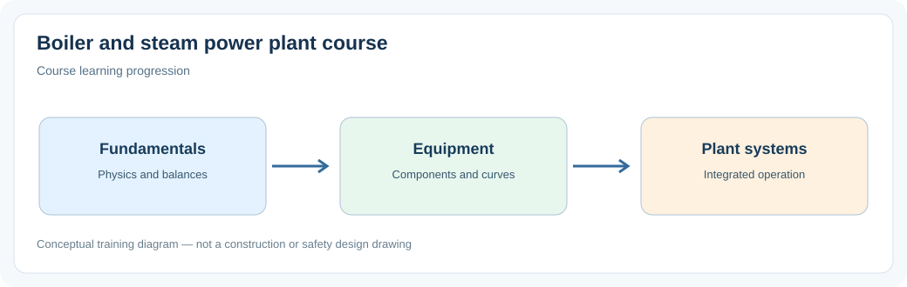

# Boiler & Steam Power Plant Engineering

> **Status:** Draft — not yet reviewed. Content may contain errors or omissions.

A practical reference course for simulation engineers, from process fundamentals to dynamic simulation.

Each chapter includes an original SVG process illustration. Images are stored locally in `assets/` and work offline in Markdown viewers that support SVG. Diagrams are conceptual, not detailed P&IDs.

## Part 1 — Engineering Fundamentals

1. Introduction to Process Engineering and Power Plants
2. Physical Quantities, Units and Engineering Conventions
3. Mass, Energy and Momentum Balances
4. Pressure, Flow and Hydraulic Principles
5. Basic Thermodynamics
6. Properties of Water and Steam
7. Heat Transfer: Conduction, Convection and Radiation
8. Fluid Dynamics and Pressure Losses
9. Fundamentals of Dynamic Process Simulation

## Part 2 — Process Equipment

1. Pipes, Fittings and Hydraulic Networks
2. Pumps and Pump Characteristics
3. Fans, Blowers and Compressors
4. Manual Valves and Isolation Valves
5. Control Valves and Actuators
6. Measurement Instruments and Sensors
7. Vessels, Tanks and Steam Drums
8. Heat Exchangers
9. Condensers and Cooling Equipment
10. Steam Traps, Separators and Drainage Systems
11. Safety Valves and Basic Protection Devices
12. Electric Motors, Drives and Variable Speed Control

## Part 3 — Boiler Technology

1. Introduction to Boilers and Boiler Classification
2. Fire-Tube Boilers
3. Water-Tube Boilers
4. Natural and Forced Circulation Boilers
5. Drum Boilers and Once-Through Boilers
6. Heat Recovery Steam Generators (HRSG)
7. Electric Boilers and Electrode Boilers
8. Boiler Fuels and Fuel Handling Systems
9. Combustion Fundamentals and Calculations
10. Burners and Combustion Equipment
11. Furnaces and Combustion Chambers
12. Evaporators and Waterwall Systems
13. Economizers
14. Superheaters and Reheaters
15. Flue Gas Systems and Heat Recovery
16. Boiler Efficiency and Heat Balances

## Part 4 — Steam Power Plant Systems

1. Overview of the Steam-Water Cycle
2. Feedwater and Condensate Systems
3. Deaerators and Feedwater Heating
4. Steam Distribution and Pressure Reduction
5. Steam Turbines
6. Generators and Electrical Power Production
7. Condensing and Vacuum Systems
8. Cooling Water Systems and Cooling Towers
9. Combustion Air and Flue Gas Systems
10. Fuel Supply and Preparation Systems
11. Water Treatment and Boiler Water Chemistry
12. Auxiliary Steam and Utility Systems
13. Rankine Cycle and Plant Efficiency

## Part 5 — Instrumentation and Basic Control

1. Process Measurements and Signal Processing
2. Control Loops and PID Controllers
3. Pump, Valve and Flow Control
4. Pressure, Temperature and Level Control
5. Basic Boiler and Steam Plant Control
6. Operating Limits and Basic Safety Principles

## Part 6 — Dynamic Simulation

1. Physical Modeling Principles
2. Modeling Fluid Flow and Pressure Networks
3. Modeling Pumps, Valves and Vessels
4. Modeling Heat Transfer and Heat Exchangers
5. Modeling Water, Steam and Phase Changes
6. Modeling Combustion and Flue Gas
7. Modeling Boiler Components
8. Modeling Steam Turbines and Condensers
9. Modeling Basic Process Control
10. Steady-State Initialization and Model Balancing
11. Dynamic Behavior During Startup and Shutdown
12. Load Changes and Transient Response
13. Model Verification, Validation and Tuning
14. Integrated Steam Power Plant Simulation

## Review and release

Track chapter approval in the [review checklist](REVIEW-CHECKLIST.md). Only reviewed chapters are ready for release.

## How to use this project

Chapter numbering restarts at 1 in each part; chapter filenames use numbers starting at 01 within each part.

Each chapter contains process principles, an engineering relationship, modeling guidance, a practical exercise and review questions. Read Parts 1–2 before combining equipment into plant systems. Part 6 develops integrated simulation exercises.

These are **introductory technical training notes**, not detailed design calculations or certified safety procedures. Simplified equations must be checked for their applicable regimes, property bases and units. Use manufacturer data and verified water/steam properties for real applications.

## Engineering characteristic graphs

Selected chapters include locally stored PNG graphs in `assets/engineering-curves/`, with units, explanatory notes, and clearly marked illustrative assumptions. They are not vendor performance data.

## Additional engineering illustrations

Every chapter includes an additional topic-specific SVG characteristic curve or response diagram in `assets/topic-curves/`. Curves are educational examples, not manufacturer data. Chapters also retain their earlier process schematics and any detailed engineering plots.
