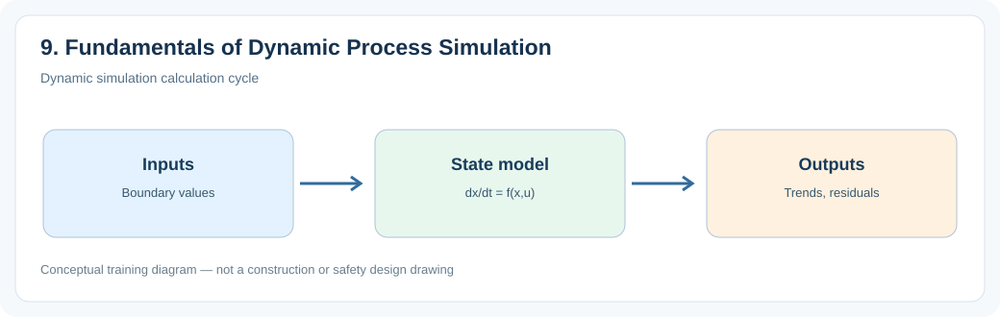
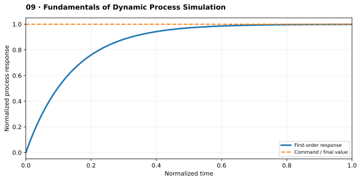

# 9. Fundamentals of Dynamic Process Simulation

> **Status:** Draft — not yet reviewed. Content may contain errors or omissions.

> **Audience:** Beginning simulation engineers  
> **Scope:** Process understanding, practical engineering calculations and introductory simulation.\

## What you will learn

- Explain the main physical function and important operating behavior of **9. fundamentals of dynamic process simulation**.
- Apply a useful engineering relationship with consistent units and assumptions.
- Identify the state variables, boundary conditions and inputs needed for a simplified dynamic model.

## Process illustration

*Figure: Dynamic simulation calculation cycle. The diagram highlights the main input, physical transformation, and output quantities relevant to a first model.*

## Additional engineering illustration — Dynamic response and time constant

*Illustrative teaching graph, not manufacturer data or a validated plant characteristic.*

**Interpretation:** A first-order response is a useful introductory approximation; real process systems can have transport delays, integrators and nonlinearities.

## Process principles

Dynamic models use differential and algebraic equations. Time step, solver stability and initial conditions affect results. Distinguish physical time constants from numerical artifacts and check conservation residuals.

## Key engineering relationship

Forward Euler: x_(k+1) = x_k + Δt f(x_k,u_k).

**Engineering note:** Check the units and validity range of this relationship. It is an introductory model or calculation, not a substitute for equipment manufacturer data, validated steam properties or detailed design standards.

## Dynamic behavior and modeling

Use cpu.scanTime consistently, limit unphysical states and test step-size sensitivity.

## Worked or practical exercise

Simulate first-order temperature response at two different scan times and compare.

**Suggested deliverable:** a calculation sheet or short explanation, a model diagram, and a trend plot of the relevant transient response. Record all assumptions.

## Review questions

1. What physical quantity is stored or transferred by this equipment or process?
2. Which input disturbance is most important for its dynamic response?
3. Which assumptions would fail outside normal operating conditions?

## References to consult

- Equipment manufacturer manuals and characteristic curves where relevant.
- IAPWS-IF97 or verified steam tables for water/steam property calculations.
- Plant P&IDs, process descriptions, operating manuals and heat/mass balances.
- Appropriate engineering standards and plant safety procedures for design or protection topics.
