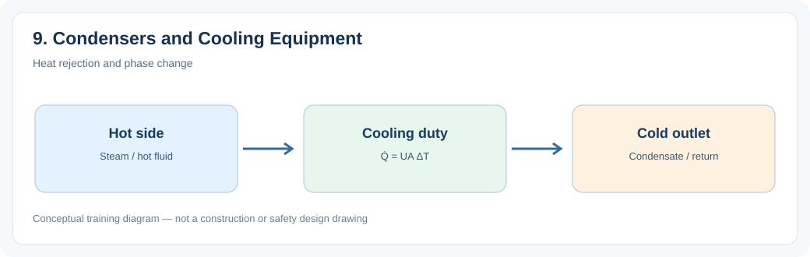
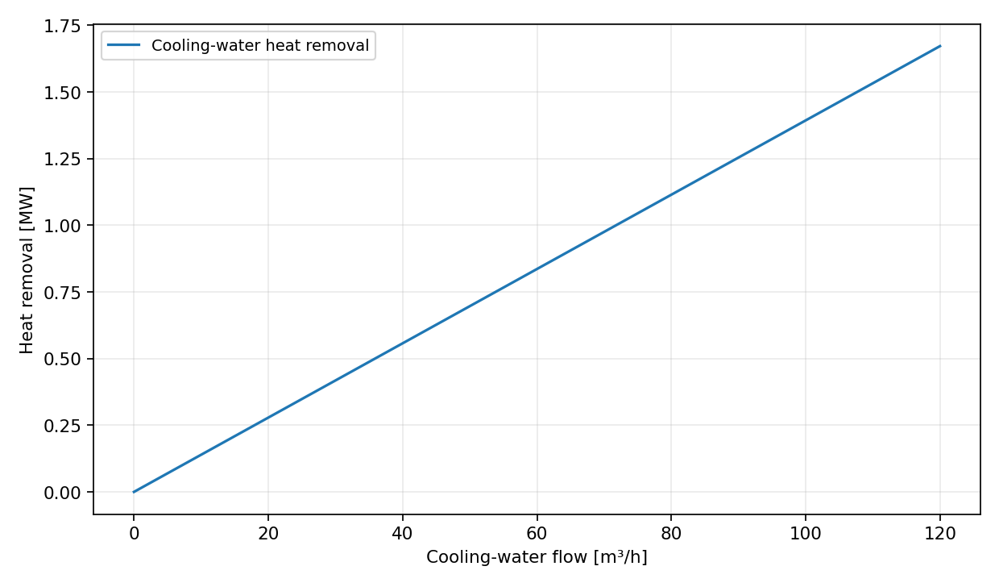
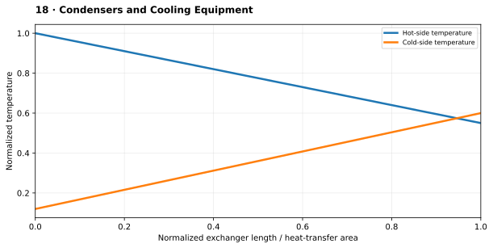

# 9. Condensers and Cooling Equipment

> **Status:** Draft — not yet reviewed. Content may contain errors or omissions.

> **Audience:** Beginning simulation engineers  
> **Scope:** Process understanding, practical engineering calculations and introductory simulation.\

## What you will learn

- Explain the main physical function and important operating behavior of **9. condensers and cooling equipment**.
- Apply a useful engineering relationship with consistent units and assumptions.
- Identify the state variables, boundary conditions and inputs needed for a simplified dynamic model.

## Process illustration

*Figure: Heat rejection and phase change. The diagram highlights the main input, physical transformation, and output quantities relevant to a first model.*

## Engineering characteristic: Cooling-water duty versus flow

*Illustrative teaching curves, not manufacturer or plant performance data.*

Assumes liquid water density ≈ 1000 kg/m³, cp = 4.18 kJ/(kg·K) and a fixed 12 K rise. This is a heat-balance illustration, not a condenser performance curve.

## Additional engineering illustration — Illustrative temperature profiles

*Illustrative teaching graph, not manufacturer data or a validated plant characteristic.*

**Interpretation:** Temperature profiles depend on flow arrangement, phase change, heat capacity rates and thermal resistances. This is a simplified co-current example.

## Process principles

Condensers remove latent heat and maintain turbine exhaust pressure. Cooling-water flow and temperature determine duty. Noncondensable gases and fouling impair heat transfer and vacuum performance.

## Key engineering relationship

Q̇ = ṁ_steam(h_in−h_condensate) ≈ ṁ_cw cp,cw(T_out−T_in).

**Engineering note:** Check the units and validity range of this relationship. It is an introductory model or calculation, not a substitute for equipment manufacturer data, validated steam properties or detailed design standards.

## Dynamic behavior and modeling

Represent condensation duty and condenser pressure as coupled states or constraints.

## Worked or practical exercise

Estimate cooling-water temperature rise for a given condenser duty and water flow.

**Suggested deliverable:** a calculation sheet or short explanation, a model diagram, and a trend plot of the relevant transient response. Record all assumptions.

## Review questions

1. What physical quantity is stored or transferred by this equipment or process?
2. Which input disturbance is most important for its dynamic response?
3. Which assumptions would fail outside normal operating conditions?

## References to consult

- Equipment manufacturer manuals and characteristic curves where relevant.
- IAPWS-IF97 or verified steam tables for water/steam property calculations.
- Plant P&IDs, process descriptions, operating manuals and heat/mass balances.
- Appropriate engineering standards and plant safety procedures for design or protection topics.
