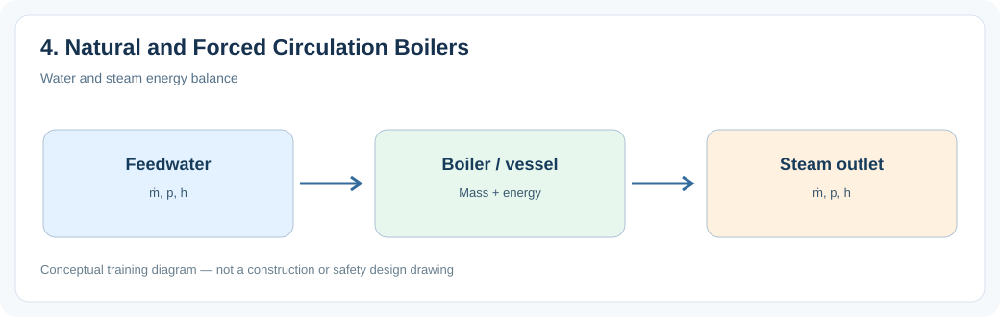
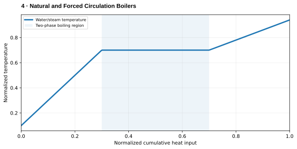

# 4. Natural and Forced Circulation Boilers

> **Status:** Draft — not yet reviewed. Content may contain errors or omissions.

> **Audience:** Beginning simulation engineers  
> **Scope:** Process understanding, practical engineering calculations and introductory simulation.\

## What you will learn

- Explain the main physical function and important operating behavior of **4. natural and forced circulation boilers**.
- Apply a useful engineering relationship with consistent units and assumptions.
- Identify the state variables, boundary conditions and inputs needed for a simplified dynamic model.

## Process illustration

*Figure: Water and steam energy balance. The diagram highlights the main input, physical transformation, and output quantities relevant to a first model.*

## Additional engineering illustration — Sensible heating, boiling and superheating

*Illustrative teaching graph, not manufacturer data or a validated plant characteristic.*

**Interpretation:** At constant pressure, temperature stays approximately constant during pure-water evaporation. Actual saturation temperature varies with pressure.

## Process principles

Natural circulation relies on density differences between heated risers and cooler downcomers. Forced circulation uses pumps to maintain flow. Flow must be sufficient to cool heated surfaces.

## Key engineering relationship

Δp_drive ≈ gH(ρ_downcomer−ρ_riser); balance against circuit friction losses.

**Engineering note:** Check the units and validity range of this relationship. It is an introductory model or calculation, not a substitute for equipment manufacturer data, validated steam properties or detailed design standards.

## Dynamic behavior and modeling

Link riser/downcomer density to thermal state and hydraulic resistance.

## Worked or practical exercise

Explain how a rise in riser void fraction can affect circulation driving head.

**Suggested deliverable:** a calculation sheet or short explanation, a model diagram, and a trend plot of the relevant transient response. Record all assumptions.

## Review questions

1. What physical quantity is stored or transferred by this equipment or process?
2. Which input disturbance is most important for its dynamic response?
3. Which assumptions would fail outside normal operating conditions?

## References to consult

- Equipment manufacturer manuals and characteristic curves where relevant.
- IAPWS-IF97 or verified steam tables for water/steam property calculations.
- Plant P&IDs, process descriptions, operating manuals and heat/mass balances.
- Appropriate engineering standards and plant safety procedures for design or protection topics.
