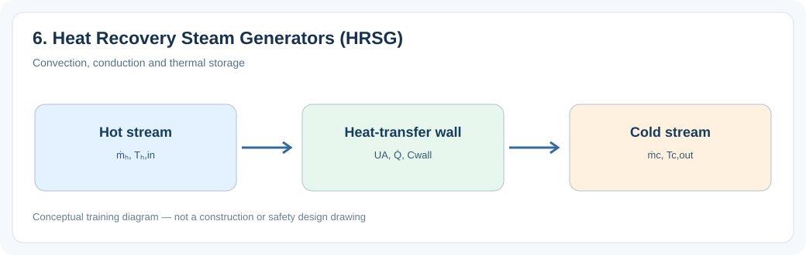
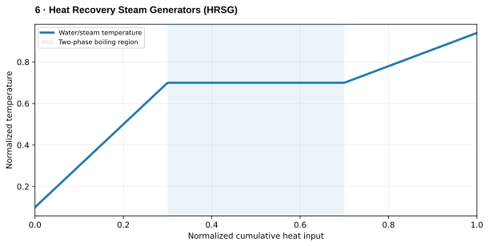

# 6. Heat Recovery Steam Generators (HRSG)

> **Status:** Draft — not yet reviewed. Content may contain errors or omissions.

> **Audience:** Beginning simulation engineers  
> **Scope:** Process understanding, practical engineering calculations and introductory simulation.\

## What you will learn

- Explain the main physical function and important operating behavior of **6. heat recovery steam generators (hrsg)**.
- Apply a useful engineering relationship with consistent units and assumptions.
- Identify the state variables, boundary conditions and inputs needed for a simplified dynamic model.

## Process illustration

*Figure: Convection, conduction and thermal storage. The diagram highlights the main input, physical transformation, and output quantities relevant to a first model.*

## Additional engineering illustration — Sensible heating, boiling and superheating

*Illustrative teaching graph, not manufacturer data or a validated plant characteristic.*

**Interpretation:** At constant pressure, temperature stays approximately constant during pure-water evaporation. Actual saturation temperature varies with pressure.

## Process principles

Heat recovery steam generators recover gas-turbine exhaust heat. They may have multiple pressure levels, economizers, evaporators, superheaters and supplementary firing. Pinch and approach temperatures constrain heat recovery.

## Key engineering relationship

Q̇_recovered ≈ ṁ_gas(h_gas,in−h_gas,out).

**Engineering note:** Check the units and validity range of this relationship. It is an introductory model or calculation, not a substitute for equipment manufacturer data, validated steam properties or detailed design standards.

## Dynamic behavior and modeling

Represent gas-side heat exchange in flow order, with separate steam pressure circuits.

## Worked or practical exercise

Sketch a single-pressure HRSG and identify gas-side and water-side temperature profiles.

**Suggested deliverable:** a calculation sheet or short explanation, a model diagram, and a trend plot of the relevant transient response. Record all assumptions.

## Review questions

1. What physical quantity is stored or transferred by this equipment or process?
2. Which input disturbance is most important for its dynamic response?
3. Which assumptions would fail outside normal operating conditions?

## References to consult

- Equipment manufacturer manuals and characteristic curves where relevant.
- IAPWS-IF97 or verified steam tables for water/steam property calculations.
- Plant P&IDs, process descriptions, operating manuals and heat/mass balances.
- Appropriate engineering standards and plant safety procedures for design or protection topics.
