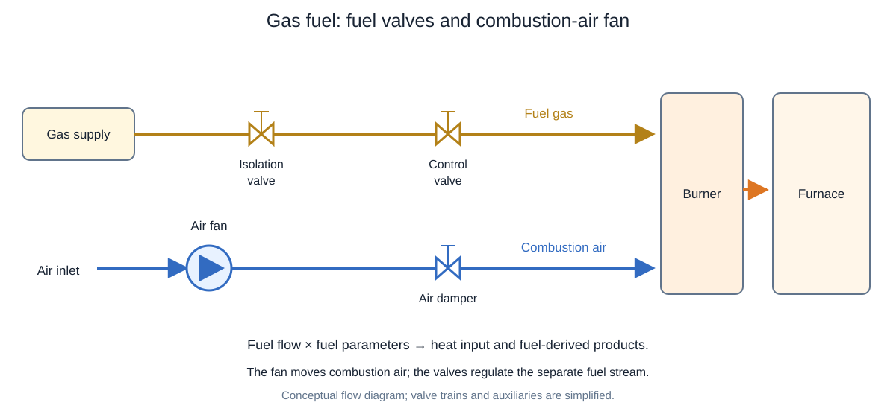
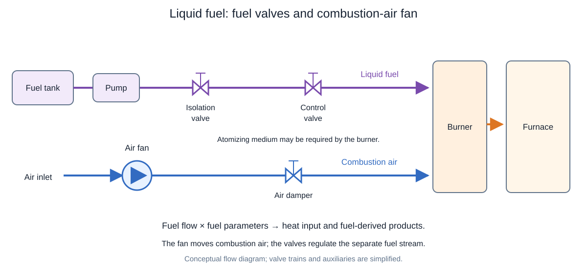
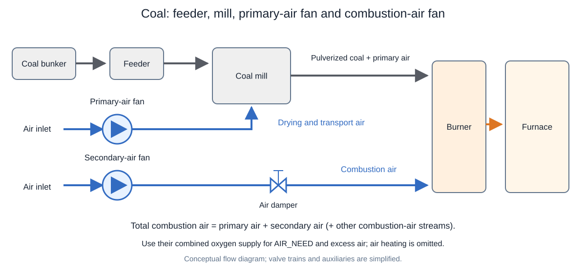

# 9. Combustion Fundamentals and Calculations

> **Status:** Draft — not yet reviewed. Content may contain errors or omissions.

> **Scope:** A unified set of fuel parameters for solid, liquid and gaseous fuels, with emphasis on the differences between fuel types.

## 9.1 One parameter set for every fuel

A burner can use the **same calculation interface** for coal, biomass, oil, natural gas or hydrogen. First determine the fuel parameters from the available fuel analysis. Then multiply those parameters by fuel mass flow.

Use **1 kg of fuel as supplied** as the common basis. Include moisture, ash and inert gases when they are part of the supplied fuel stream.

| Fuel parameter | Meaning | Unit |
| --- | --- | --- |
| `HHV` | Heat released with product water condensed at the reference temperature | kJ/kg fuel |
| `LHV` | Heat released with product water remaining as vapor | kJ/kg fuel |
| `O2_NEED` | External oxygen needed for complete combustion | kg O₂/kg fuel |
| `AIR_NEED` | Air needed for complete combustion at the selected air composition | kg air/kg fuel |
| `CO2_PROD` | CO₂ leaving from the fuel, including any CO₂ already in the fuel stream | kg CO₂/kg fuel |
| `H2O_PROD` | H₂O leaving from the fuel, including fuel moisture or inlet water vapor | kg H₂O/kg fuel |
| `SO2_PROD` | SO₂ leaving from fuel sulfur, assuming all sulfur becomes SO₂ | kg SO₂/kg fuel |
| `N2_PROD` | N₂ leaving from fuel nitrogen, assuming all fuel nitrogen becomes N₂ | kg N₂/kg fuel |
| `ASH` | Inert solid residue accounted for separately from flue gas | kg ash/kg fuel |

**Production convention:** To match the supplied burner model, `CO2_PROD` and `H2O_PROD` mean the **total fuel contribution to the outlet**, not necessarily newly formed material. Air-side CO₂ and humidity are added separately. For fresh CO₂ or H₂O formation only, subtract the corresponding inlet amount.

The parameters assume complete combustion. They do not describe CO, unburned fuel, NOₓ or the distribution of sulfur between gas and ash.

## 9.2 What differs between solid, liquid and gas fuels?

The parameter names and units stay the same. **The fuel analysis used to obtain them changes.**

| Aspect | Solid fuel | Liquid fuel | Gas fuel |
| --- | --- | --- | --- |
| Typical examples | Coal, wood, biomass | Fuel oil, diesel, alcohol | Natural gas, biogas, hydrogen, fuel gas |
| Usual input analysis | Elemental mass fractions, moisture and ash | Elemental mass fractions or molecular composition; water content | Species mole fractions, often reported as volume percentages |
| Heating-value source | Measured value; validated elemental correlation if needed | Measured value; validated correlation if appropriate | Supplier data or species combustion enthalpies |
| Moisture or water | Can be substantial; usually supplied as liquid moisture in the fuel analysis | Often low in oil, but may be significant in wet fuels or emulsions | May enter as vapor; wet versus dry gas analysis matters |
| Ash or inert material | Often important; lowers heating value per kg supplied | Usually low for distillates; heavier fuels may contain ash-forming material | N₂ and CO₂ can dilute the fuel; solid ash is normally absent for clean gas |
| Oxygen already in fuel | Important for biomass and other oxygen-rich fuels | Important for alcohols and other oxygenated liquids | Species such as CO and oxygenated gases require species balances |
| Main conversion step | Convert dry analysis to as-received mass fractions | Keep composition and heating value on the same wet or dry basis | Convert species mole fractions to parameters per kg of the mixture |

There is no single LHV or air requirement for a fuel phase. A wet solid and a dry solid can differ greatly. Hydrogen and methane are both gases but have very different `LHV`, `AIR_NEED` and `CO2_PROD`.

### Typical fuel and air systems

**Gas fuel — gas valves and a separate combustion-air fan**

The gas valves control fuel flow. The fan supplies combustion air. Gas pressure comes from the supply system; a fuel-gas booster is not shown. Gas composition determines `LHV`, `HHV`, `AIR_NEED` and the product parameters.

**Liquid fuel — pump, fuel valves and a separate combustion-air fan**

The pump provides fuel pressure and the valves control liquid flow. The fan supplies combustion air. Some burners also need atomizing steam or air. Include atomizing steam in the outlet water balance, or atomizing air in the air and oxygen balance, when present; neither changes the fuel's intrinsic parameters.

**Coal — feeder, mill, primary-air fan and secondary-air fan**

The mill pulverizes coal. Primary air dries and transports it to the burner; secondary air supplies additional combustion air. Count both air streams when checking `AIR_NEED` and excess air. If drying removes coal moisture into the primary-air stream, count that water once in the combined outlet balance. Moisture and ash remain part of the as-received fuel parameters.

These arrangements change fuel delivery and mixing. The unified fuel parameters and burner multiplication formulas remain the same.

## 9.3 Solid and liquid fuels: parameters from mass fractions

Let $w_C,w_H,w_O,w_S,w_N,w_M,w_A$ be the mass fractions of carbon, hydrogen, oxygen, sulfur, nitrogen, moisture and ash. Enter **fractions, not percentages**: 65% carbon means $w_C=0.65$.

Hydrogen and oxygen already included in moisture are excluded from $w_H$ and $w_O$. All fractions refer to the same kilogram of supplied fuel:

$$w_C+w_H+w_O+w_S+w_N+w_M+w_A=1.$$

The supplied burner model uses:

$$\boxed{\text{CO2\_PROD}=w_C\frac{44.01}{12.01}}$$

$$\boxed{\text{H2O\_PROD}=w_H\frac{18.02}{2.02}+w_M}$$

$$\boxed{\text{O2\_NEED}=w_C\frac{32.00}{12.01}+w_H\frac{16.00}{2.02}-w_O+w_S\frac{32.00}{32.07}}$$

$$\text{SO2\_PROD}=w_S\frac{64.07}{32.07},\qquad\text{N2\_PROD}=w_N,\qquad\text{ASH}=w_A.$$

All results are **kg per kg of supplied fuel**. More carbon increases `CO2_PROD`; more hydrogen increases formed water; fuel moisture increases `H2O_PROD` without consuming oxygen. Fuel-bound oxygen reduces `O2_NEED`.

For a dry-basis analysis, convert each dry constituent, including ash, before applying these formulas:

$$w_{j,as\ received}=(1-w_M)w_{j,dry}.$$

This conversion is especially important for solid fuels. The same elemental formulas also work for a liquid fuel; its physical phase does not change the atom balance.

## 9.4 Gas fuels: parameters from species composition

Gas analysis normally gives mole fractions $y_j$. These are **not mass fractions**. First calculate the mixture molar mass:

$$M_{mix}=\sum_j y_jM_j\quad[\mathrm{kg/kmol}].$$

For a species $\mathrm{C_aH_bO_cS_d}$, complete combustion needs $a+b/4+d-c/2$ kmol O₂ per kmol species. Thus, per kilogram of gas mixture:

$$\boxed{\text{O2\_NEED}=\frac{32}{M_{mix}}\sum_j y_j\left(a_j+\frac{b_j}{4}+d_j-\frac{c_j}{2}\right)}$$

$$\boxed{\text{CO2\_PROD}=\frac{44}{M_{mix}}\sum_j y_ja_j,\qquad\text{H2O\_PROD}=\frac{18}{M_{mix}}\sum_j y_j\frac{b_j}{2}.}$$

These expressions use rounded molar masses. Include inlet CO₂ and H₂O in the species list so their outlet contributions are counted once. Inert N₂ is carried through. Species with no carbon or hydrogen contribute zero to the corresponding sum.

| Gas species | O₂ demand, kmol/kmol species | Fuel-derived CO₂, kmol/kmol | Fuel-derived H₂O, kmol/kmol |
| --- | ---: | ---: | ---: |
| CH₄ | 2 | 1 | 2 |
| H₂ | 0.5 | 0 | 1 |
| CO | 0.5 | 1 | 0 |
| Inlet CO₂ | 0 | 1, carried through | 0 |
| Inlet H₂O | 0 | 0 | 1, carried through |
| N₂ | 0 | 0 | 0 |

**Key difference:** CO₂ and N₂ dilution lower heating value per kg of a gas mixture. Inlet CO₂ also increases the fuel-derived outlet CO₂, although it is not newly produced by combustion. Hydrogen fuel has `CO2_PROD = 0`, but a high `H2O_PROD` per kilogram.

## 9.5 HHV and LHV: same definition, different input data

**HHV** includes water condensation heat. **LHV** excludes it. This definition is identical for all three fuel types. The difference depends on the water formed, initial moisture and its reference state.

### Solid and liquid fuel

Use measured `HHV` when available. For suitable elemental fuel analyses, the supplied model estimates:

$$\boxed{HHV=33830w_C+144280\left(w_H-\frac{w_O}{8}\right)+9420w_S\quad[\mathrm{kJ/kg}].}$$

This empirical estimate must be validated for the fuel. With initial moisture treated as liquid, its LHV correction is:

$$\boxed{LHV=HHV-2442.5\,\text{H2O\_PROD}\quad[\mathrm{kJ/kg}].}$$

For **solid fuel**, both hydrogen-derived water and fuel moisture may be important. For **dry liquid fuel**, the moisture term is near zero, but hydrogen still creates water. Wet liquid fuel uses the same moisture correction as wet solid fuel.

### Gas fuel

Use gas supplier values or species combustion enthalpies. With species heating values $HHV_j$ and $LHV_j$ in kJ/kmol:

$$\boxed{HHV_{mix}=\frac{\sum_j y_jHHV_j}{M_{mix}},\qquad LHV_{mix}=\frac{\sum_j y_jLHV_j}{M_{mix}}\quad[\mathrm{kJ/kg}].}$$

For a **dry gas**, the approximate difference is:

$$HHV-LHV\approx2442.5\,m_{H_2O,formed}\quad[\mathrm{kJ/kg\ fuel}].$$

For dry methane, all fuel-derived outlet water is newly formed, so this has the same form as the liquid-moisture equation. For a gas already containing **water vapor**, `H2O_PROD` also includes carried-through vapor. Use consistent species heating values and reference states; do not automatically apply the liquid-moisture correction to all of that water.

**Do not apply the elemental HHV correlation universally to gas fuels.** For example, it predicts zero heating value for CO because its carbon and oxygen terms cancel, although CO is combustible.

## 9.6 AIR_NEED and the common burner calculation

Once `O2_NEED` is known, the air calculation is the same for every fuel:

$$\boxed{\text{AIR\_NEED}=\frac{\text{O2\_NEED}}{z_{O_2}}\quad[\mathrm{kg\ air/kg\ fuel}].}$$

Here $z_{O_2}$ is the inlet-air oxygen **mass fraction**; approximately 0.232 for dry air. `AIR_NEED` therefore depends on the selected air composition as well as the fuel.

For fuel flow $\dot m_f$ in kg/s and excess-air ratio $\lambda$:

| Burner result | Common calculation | Unit |
| --- | --- | --- |
| LHV heat input | $\dot Q=\dot m_f LHV/1000$ | MW, with LHV in kJ/kg |
| Actual air flow | $\dot m_a=\lambda\dot m_f\,\text{AIR\_NEED}$ | kg/s |
| Fuel-derived CO₂ flow | $\dot m_{CO_2,f}=\dot m_f\,\text{CO2\_PROD}$ | kg/s |
| Fuel-derived H₂O flow | $\dot m_{H_2O,f}=\dot m_f\,\text{H2O\_PROD}$ | kg/s |
| Fuel-derived SO₂ flow | $\dot m_{SO_2,f}=\dot m_f\,\text{SO2\_PROD}$ | kg/s |
| Fuel-derived N₂ flow | $\dot m_{N_2,f}=\dot m_f\,\text{N2\_PROD}$ | kg/s |
| Separate ash flow | $\dot m_{ash}=\dot m_f\,\text{ASH}$ | kg/s |
| Unused oxygen | $\dot m_{O_2,out}=\dot m_a z_{O_2}-\dot m_f\,\text{O2\_NEED}$ | kg/s |

Add air-side CO₂, humidity, N₂ and other species to obtain total outlet flows. At $\lambda=1$ the air supply is stoichiometric; $\lambda=1.20$ means 20% excess air. Insufficient air requires an incomplete-combustion model.

## 9.7 Comparing the unified parameters

The following are **teaching examples**, not fuel specifications. Air uses $z_{O_2}=0.232$. Solid and liquid results use the model's molecular masses; methane and hydrogen use rounded molar masses.

- **Solid:** $w_C=0.65$, $w_H=0.045$, $w_O=0.08$, $w_S=0.015$, $w_N=0.01$, $w_M=0.12$, $w_A=0.08$. HHV is estimated with the model correlation.
- **Liquid:** dry hydrocarbon with $w_C=0.86$, $w_H=0.14$; assumed HHV = 46,000 kJ/kg.
- **Methane:** pure dry CH₄; assumed HHV = 55,500 kJ/kg.
- **Hydrogen:** pure dry H₂; assumed HHV = 142,000 kJ/kg.

| Parameter, per kg supplied fuel | Solid example | Liquid example | Methane gas | Hydrogen gas |
| --- | ---: | ---: | ---: | ---: |
| `HHV`, kJ/kg | 27,181 | 46,000 | 55,500 | 142,000 |
| `LHV`, kJ/kg | 25,907 | 42,950 | 50,004 | 120,018 |
| `O2_NEED`, kg/kg | 2.023 | 3.400 | 4.000 | 8.000 |
| `AIR_NEED`, kg/kg | 8.721 | 14.657 | 17.241 | 34.483 |
| `CO2_PROD`, kg/kg | 2.382 | 3.151 | 2.750 | 0 |
| `H2O_PROD`, kg/kg | 0.521 | 1.249 | 2.250 | 9.000 |
| `SO2_PROD`, kg/kg | 0.030 | 0 | 0 | 0 |
| `N2_PROD`, kg/kg | 0.010 | 0 | 0 | 0 |
| `ASH`, kg/kg | 0.080 | 0 | 0 | 0 |

**Read the differences:** The solid example includes moisture and ash. The dry liquid forms water mainly from its hydrogen. Methane forms more water per kg than the liquid example. Hydrogen produces no CO₂ and has the highest water production and air demand **per kg fuel** in this table.

For an equal-duty comparison, normalize by LHV rather than comparing kilograms of fuel alone:

$$\text{CO₂ per MJ}=\frac{\text{CO2\_PROD}}{LHV/1000},\qquad\text{air per MJ}=\frac{\text{AIR\_NEED}}{LHV/1000}.$$

For example, the liquid requires about 0.341 kg stoichiometric air/MJ and hydrogen about 0.287 kg/MJ. Hydrogen's larger air demand per kilogram of fuel therefore does not imply a larger air demand per unit of heat.

**Example of using the interface:** At 2 kg/s of the solid fuel, LHV heat input is 51.814 MW, fuel-derived CO₂ flow is 4.764 kg/s, and fuel-derived H₂O flow is 1.043 kg/s. Only the fuel parameters change when another fuel is selected; these multiplication formulas remain the same.

## References

- Supplied **SF_BURNER.xml**: model coefficients and the fuel-derived product convention.
- [U.S. Department of Energy — Fuel glossary](https://www.energy.gov/cmei/fuels/glossary): HHV and LHV definitions.
- Fuel supplier analyses and heating values, with composition basis, moisture and reference conditions stated.
