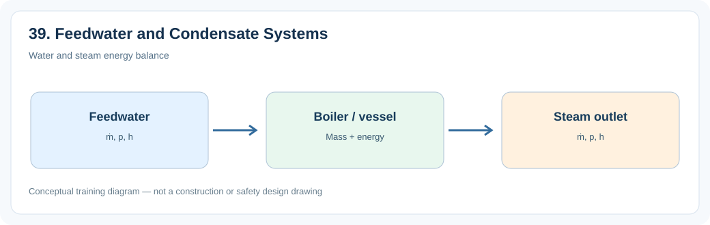
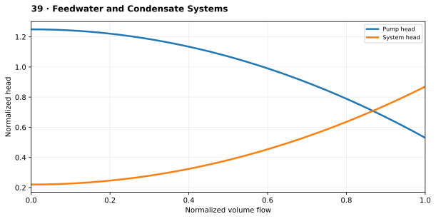

# 2. Feedwater and Condensate Systems

> **Status:** Draft — not yet reviewed. Content may contain errors or omissions.

> **Audience:** Beginning simulation engineers  
> **Scope:** Process understanding, practical engineering calculations and introductory simulation.\

## What you will learn

- Explain the main physical function and important operating behavior of **2. feedwater and condensate systems**.
- Apply a useful engineering relationship with consistent units and assumptions.
- Identify the state variables, boundary conditions and inputs needed for a simplified dynamic model.

## Process illustration

*Figure: Water and steam energy balance. The diagram highlights the main input, physical transformation, and output quantities relevant to a first model.*

## Additional engineering illustration — Pump and system operating point

*Illustrative teaching graph, not manufacturer data or a validated plant characteristic.*

**Interpretation:** The intersection of pump and system curves defines the steady operating point. For NPSH and efficiency see the dedicated pump graphs.

## Process principles

Condensate pumps and boiler feedwater pumps move water from condenser to boiler pressure. Tanks, heaters, control valves and recirculation lines protect flow and manage inventory.

## Key engineering relationship

Pump head requirement ≈ pressure rise/(ρg) + elevation and friction head.

**Engineering note:** Check the units and validity range of this relationship. It is an introductory model or calculation, not a substitute for equipment manufacturer data, validated steam properties or detailed design standards.

## Dynamic behavior and modeling

Represent suction and discharge nodes, pump curves and inventory dynamics.

## Worked or practical exercise

Simulate a feedwater pump speed change while holding a fixed boiler demand.

**Suggested deliverable:** a calculation sheet or short explanation, a model diagram, and a trend plot of the relevant transient response. Record all assumptions.

## Review questions

1. What physical quantity is stored or transferred by this equipment or process?
2. Which input disturbance is most important for its dynamic response?
3. Which assumptions would fail outside normal operating conditions?

## References to consult

- Equipment manufacturer manuals and characteristic curves where relevant.
- IAPWS-IF97 or verified steam tables for water/steam property calculations.
- Plant P&IDs, process descriptions, operating manuals and heat/mass balances.
- Appropriate engineering standards and plant safety procedures for design or protection topics.
