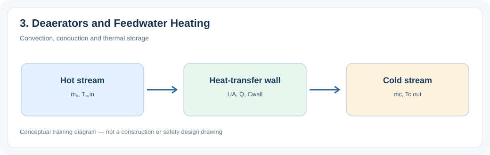
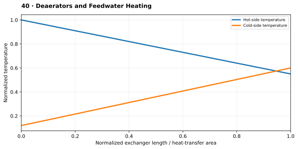

# 3. Deaerators and Feedwater Heating

> **Status:** Draft — not yet reviewed. Content may contain errors or omissions.

> **Audience:** Beginning simulation engineers  
> **Scope:** Process understanding, practical engineering calculations and introductory simulation.\

## What you will learn

- Explain the main physical function and important operating behavior of **3. deaerators and feedwater heating**.
- Apply a useful engineering relationship with consistent units and assumptions.
- Identify the state variables, boundary conditions and inputs needed for a simplified dynamic model.

## Process illustration

*Figure: Convection, conduction and thermal storage. The diagram highlights the main input, physical transformation, and output quantities relevant to a first model.*

## Additional engineering illustration — Illustrative temperature profiles

*Illustrative teaching graph, not manufacturer data or a validated plant characteristic.*

**Interpretation:** Temperature profiles depend on flow arrangement, phase change, heat capacity rates and thermal resistances. This is a simplified co-current example.

## Process principles

Deaerators remove dissolved oxygen and heat feedwater with steam. Feedwater heaters use turbine extraction steam to improve cycle efficiency. Condensate level and extraction steam supply interact.

## Key engineering relationship

ṁ_1h_1 + ṁ_2h_2 = (ṁ_1+ṁ_2)h_out for ideal adiabatic mixing.

**Engineering note:** Check the units and validity range of this relationship. It is an introductory model or calculation, not a substitute for equipment manufacturer data, validated steam properties or detailed design standards.

## Dynamic behavior and modeling

Model mixing, inventory and pressure-dependent saturation conditions.

## Worked or practical exercise

Calculate mixed-water enthalpy from two inlet streams.

**Suggested deliverable:** a calculation sheet or short explanation, a model diagram, and a trend plot of the relevant transient response. Record all assumptions.

## Review questions

1. What physical quantity is stored or transferred by this equipment or process?
2. Which input disturbance is most important for its dynamic response?
3. Which assumptions would fail outside normal operating conditions?

## References to consult

- Equipment manufacturer manuals and characteristic curves where relevant.
- IAPWS-IF97 or verified steam tables for water/steam property calculations.
- Plant P&IDs, process descriptions, operating manuals and heat/mass balances.
- Appropriate engineering standards and plant safety procedures for design or protection topics.
