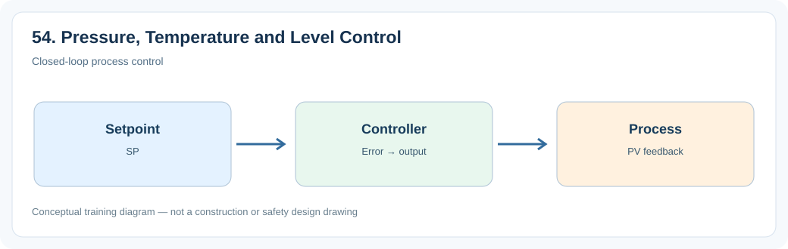
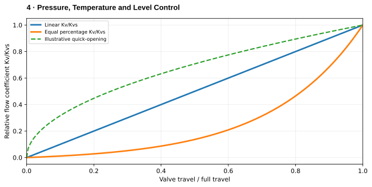

# 4. Pressure, Temperature and Level Control

> **Status:** Draft — not yet reviewed. Content may contain errors or omissions.

> **Audience:** Beginning simulation engineers  
> **Scope:** Process understanding, practical engineering calculations and introductory simulation.\

## What you will learn

- Explain the main physical function and important operating behavior of **4. pressure, temperature and level control**.
- Apply a useful engineering relationship with consistent units and assumptions.
- Identify the state variables, boundary conditions and inputs needed for a simplified dynamic model.

## Process illustration

*Figure: Closed-loop process control. The diagram highlights the main input, physical transformation, and output quantities relevant to a first model.*

## Additional engineering illustration — Inherent valve characteristics

*Illustrative teaching graph, not manufacturer data or a validated plant characteristic.*

**Interpretation:** These are inherent characteristics at constant differential pressure; installed characteristics change with the hydraulic system.

## Process principles

Pressure, temperature and level respond to different inventories. Pressure in compressible volumes can respond quickly, while temperature changes are limited by thermal mass. Level control must consider inflow/outflow balance.

## Key engineering relationship

A dh/dt = (Q_in−Q_out) for a constant-area incompressible tank.

**Engineering note:** Check the units and validity range of this relationship. It is an introductory model or calculation, not a substitute for equipment manufacturer data, validated steam properties or detailed design standards.

## Dynamic behavior and modeling

Choose a process state, sensor lag and suitable actuator for each loop.

## Worked or practical exercise

Compare responses of a level loop and a temperature loop to identical controller gains.

**Suggested deliverable:** a calculation sheet or short explanation, a model diagram, and a trend plot of the relevant transient response. Record all assumptions.

## Review questions

1. What physical quantity is stored or transferred by this equipment or process?
2. Which input disturbance is most important for its dynamic response?
3. Which assumptions would fail outside normal operating conditions?

## References to consult

- Equipment manufacturer manuals and characteristic curves where relevant.
- IAPWS-IF97 or verified steam tables for water/steam property calculations.
- Plant P&IDs, process descriptions, operating manuals and heat/mass balances.
- Appropriate engineering standards and plant safety procedures for design or protection topics.
