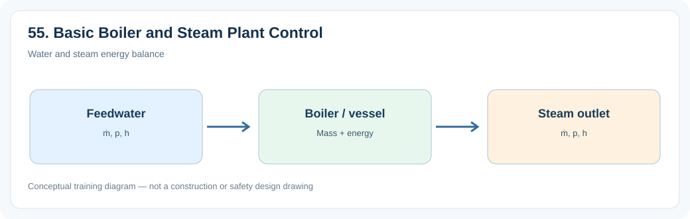
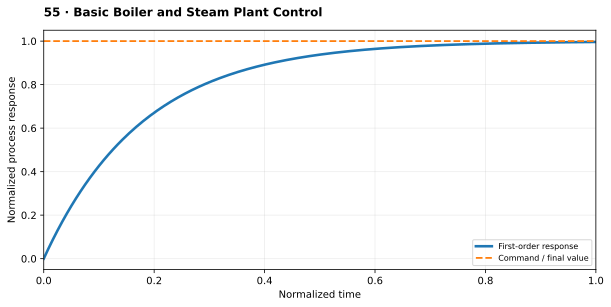

# 5. Basic Boiler and Steam Plant Control

> **Status:** Draft — not yet reviewed. Content may contain errors or omissions.

> **Audience:** Beginning simulation engineers  
> **Scope:** Process understanding, practical engineering calculations and introductory simulation.\

## What you will learn

- Explain the main physical function and important operating behavior of **5. basic boiler and steam plant control**.
- Apply a useful engineering relationship with consistent units and assumptions.
- Identify the state variables, boundary conditions and inputs needed for a simplified dynamic model.

## Process illustration

*Figure: Water and steam energy balance. The diagram highlights the main input, physical transformation, and output quantities relevant to a first model.*

## Additional engineering illustration — Dynamic response and time constant

*Illustrative teaching graph, not manufacturer data or a validated plant characteristic.*

**Interpretation:** A first-order response is a useful introductory approximation; real process systems can have transport delays, integrators and nonlinearities.

## Process principles

Basic boiler control maintains steam pressure, feedwater inventory and steam temperature. Combustion and feedwater flows respond to demand, while basic supervisory limits prevent unrealistic operating conditions.

## Key engineering relationship

dM_drum/dt = ṁ_feedwater−ṁ_steam−ṁ_blowdown.

**Engineering note:** Check the units and validity range of this relationship. It is an introductory model or calculation, not a substitute for equipment manufacturer data, validated steam properties or detailed design standards.

## Dynamic behavior and modeling

Build one simple steam-pressure loop and one feedwater-level loop.

## Worked or practical exercise

Increase steam demand and observe pressure and level transients.

**Suggested deliverable:** a calculation sheet or short explanation, a model diagram, and a trend plot of the relevant transient response. Record all assumptions.

## Review questions

1. What physical quantity is stored or transferred by this equipment or process?
2. Which input disturbance is most important for its dynamic response?
3. Which assumptions would fail outside normal operating conditions?

## References to consult

- Equipment manufacturer manuals and characteristic curves where relevant.
- IAPWS-IF97 or verified steam tables for water/steam property calculations.
- Plant P&IDs, process descriptions, operating manuals and heat/mass balances.
- Appropriate engineering standards and plant safety procedures for design or protection topics.
