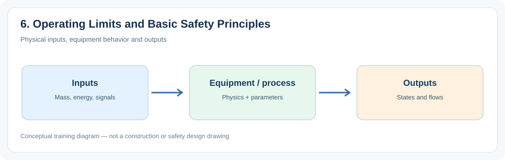
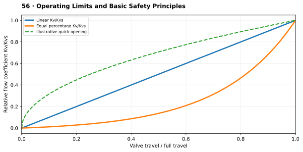

# 6. Operating Limits and Basic Safety Principles

> **Status:** Draft — not yet reviewed. Content may contain errors or omissions.

> **Audience:** Beginning simulation engineers  
> **Scope:** Process understanding, practical engineering calculations and introductory simulation.\

## What you will learn

- Explain the main physical function and important operating behavior of **6. operating limits and basic safety principles**.
- Apply a useful engineering relationship with consistent units and assumptions.
- Identify the state variables, boundary conditions and inputs needed for a simplified dynamic model.

## Process illustration

*Figure: Physical inputs, equipment behavior and outputs. The diagram highlights the main input, physical transformation, and output quantities relevant to a first model.*

## Additional engineering illustration — Inherent valve characteristics

*Illustrative teaching graph, not manufacturer data or a validated plant characteristic.*

**Interpretation:** These are inherent characteristics at constant differential pressure; installed characteristics change with the hydraulic system.

## Process principles

Plant operation is bounded by pressure, temperature, water level and equipment flow limits. Alarms notify operators; interlocks and trips change equipment state. A training model illustrates behavior but is not a safety system.

## Key engineering relationship

Simple high-high trip: trip = (PV ≥ limit); optional reset requires separate conditions.

**Engineering note:** Check the units and validity range of this relationship. It is an introductory model or calculation, not a substitute for equipment manufacturer data, validated steam properties or detailed design standards.

## Dynamic behavior and modeling

Use clear alarm and trip flags without implying safety certification.

## Worked or practical exercise

Trigger an overtemperature alarm and show its effect on a simplified burner enable signal.

**Suggested deliverable:** a calculation sheet or short explanation, a model diagram, and a trend plot of the relevant transient response. Record all assumptions.

## Review questions

1. What physical quantity is stored or transferred by this equipment or process?
2. Which input disturbance is most important for its dynamic response?
3. Which assumptions would fail outside normal operating conditions?

## References to consult

- Equipment manufacturer manuals and characteristic curves where relevant.
- IAPWS-IF97 or verified steam tables for water/steam property calculations.
- Plant P&IDs, process descriptions, operating manuals and heat/mass balances.
- Appropriate engineering standards and plant safety procedures for design or protection topics.
