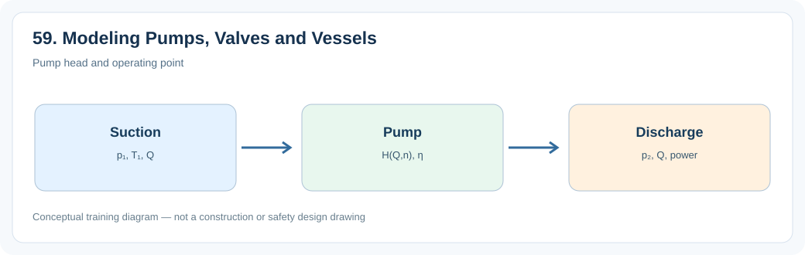
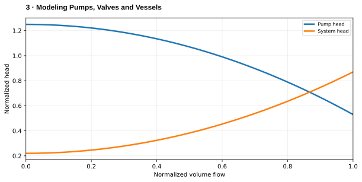

# 3. Modeling Pumps, Valves and Vessels

> **Status:** Draft — not yet reviewed. Content may contain errors or omissions.

> **Audience:** Beginning simulation engineers  
> **Scope:** Process understanding, practical engineering calculations and introductory simulation.\

## What you will learn

- Explain the main physical function and important operating behavior of **3. modeling pumps, valves and vessels**.
- Apply a useful engineering relationship with consistent units and assumptions.
- Identify the state variables, boundary conditions and inputs needed for a simplified dynamic model.

## Process illustration

*Figure: Pump head and operating point. The diagram highlights the main input, physical transformation, and output quantities relevant to a first model.*

## Additional engineering illustration — Pump and system operating point

*Illustrative teaching graph, not manufacturer data or a validated plant characteristic.*

**Interpretation:** The intersection of pump and system curves defines the steady operating point. For NPSH and efficiency see the dedicated pump graphs.

## Process principles

Combine pump head curves, valve flow characteristics and vessel inventory into a dynamic circuit. The pump determines available head; valves and pipes determine resistance; the vessel stores fluid.

## Key engineering relationship

dM_vessel/dt = ṁ_in−ṁ_out; Δp_pump = ρgH(Q,n).

**Engineering note:** Check the units and validity range of this relationship. It is an introductory model or calculation, not a substitute for equipment manufacturer data, validated steam properties or detailed design standards.

## Dynamic behavior and modeling

Use explicit states for vessel level and pump speed, algebraic network flows.

## Worked or practical exercise

Simulate filling a tank with a variable-speed pump and outlet control valve.

**Suggested deliverable:** a calculation sheet or short explanation, a model diagram, and a trend plot of the relevant transient response. Record all assumptions.

## Review questions

1. What physical quantity is stored or transferred by this equipment or process?
2. Which input disturbance is most important for its dynamic response?
3. Which assumptions would fail outside normal operating conditions?

## References to consult

- Equipment manufacturer manuals and characteristic curves where relevant.
- IAPWS-IF97 or verified steam tables for water/steam property calculations.
- Plant P&IDs, process descriptions, operating manuals and heat/mass balances.
- Appropriate engineering standards and plant safety procedures for design or protection topics.
