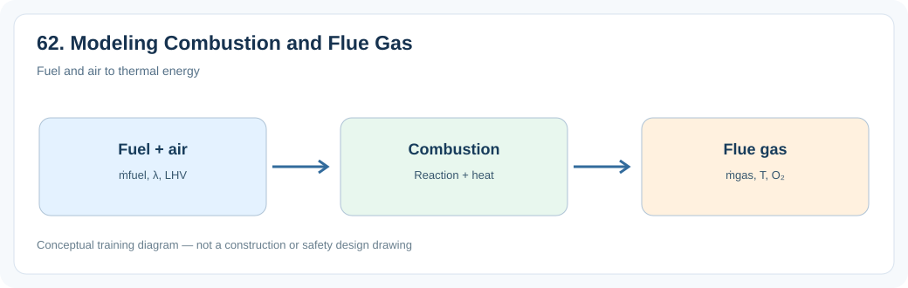
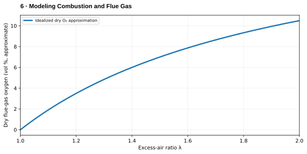

# 6. Modeling Combustion and Flue Gas

> **Status:** Draft — not yet reviewed. Content may contain errors or omissions.

> **Audience:** Beginning simulation engineers  
> **Scope:** Process understanding, practical engineering calculations and introductory simulation.\

## What you will learn

- Explain the main physical function and important operating behavior of **6. modeling combustion and flue gas**.
- Apply a useful engineering relationship with consistent units and assumptions.
- Identify the state variables, boundary conditions and inputs needed for a simplified dynamic model.

## Process illustration

*Figure: Fuel and air to thermal energy. The diagram highlights the main input, physical transformation, and output quantities relevant to a first model.*

## Additional engineering illustration — Oxygen versus excess-air ratio

*Illustrative teaching graph, not manufacturer data or a validated plant characteristic.*

**Interpretation:** Qualitative trend only: the exact dry O₂ relationship depends on fuel composition and combustion products; use species balances for calculations.

## Process principles

A combustion block transforms fuel and oxygen into products and heat. Check atomic and mass conservation, moisture basis, air composition and LHV convention. Separate chemistry from heat transfer to the furnace.

## Key engineering relationship

CH₄ + 2O₂ → CO₂ + 2H₂O; Q̇_release = ṁ_fuel LHV × combustion efficiency.

**Engineering note:** Check the units and validity range of this relationship. It is an introductory model or calculation, not a substitute for equipment manufacturer data, validated steam properties or detailed design standards.

## Dynamic behavior and modeling

Calculate species molar flows, convert to mass flows, and close the energy balance.

## Worked or practical exercise

Build a methane-air burner model with adjustable excess-air ratio.

**Suggested deliverable:** a calculation sheet or short explanation, a model diagram, and a trend plot of the relevant transient response. Record all assumptions.

## Review questions

1. What physical quantity is stored or transferred by this equipment or process?
2. Which input disturbance is most important for its dynamic response?
3. Which assumptions would fail outside normal operating conditions?

## References to consult

- Equipment manufacturer manuals and characteristic curves where relevant.
- IAPWS-IF97 or verified steam tables for water/steam property calculations.
- Plant P&IDs, process descriptions, operating manuals and heat/mass balances.
- Appropriate engineering standards and plant safety procedures for design or protection topics.
