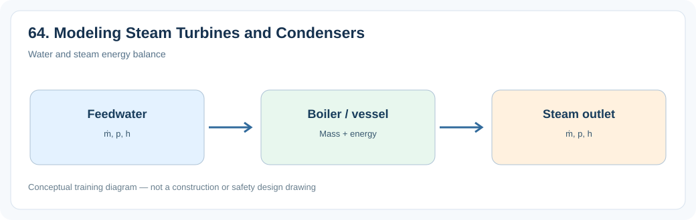
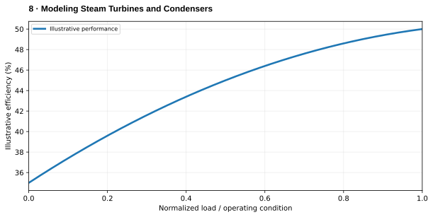

# 8. Modeling Steam Turbines and Condensers

> **Status:** Draft — not yet reviewed. Content may contain errors or omissions.

> **Audience:** Beginning simulation engineers  
> **Scope:** Process understanding, practical engineering calculations and introductory simulation.\

## What you will learn

- Explain the main physical function and important operating behavior of **8. modeling steam turbines and condensers**.
- Apply a useful engineering relationship with consistent units and assumptions.
- Identify the state variables, boundary conditions and inputs needed for a simplified dynamic model.

## Process illustration

*Figure: Water and steam energy balance. The diagram highlights the main input, physical transformation, and output quantities relevant to a first model.*

## Additional engineering illustration — Performance versus load

*Illustrative teaching graph, not manufacturer data or a validated plant characteristic.*

**Interpretation:** Illustrative trend only, not a plant efficiency prediction. Calculate actual performance using mass and energy balances.

## Process principles

Turbine and condenser models exchange steam flow, exhaust enthalpy and backpressure. Turbine power depends on expansion; condenser performance changes exhaust pressure and therefore turbine output.

## Key engineering relationship

Ẇ_turb = ṁ(h_in−h_out); Q̇_cond = ṁ(h_exhaust−h_condensate).

**Engineering note:** Check the units and validity range of this relationship. It is an introductory model or calculation, not a substitute for equipment manufacturer data, validated steam properties or detailed design standards.

## Dynamic behavior and modeling

Use consistent steam-property calculations and dynamic condenser heat removal.

## Worked or practical exercise

Increase cooling-water inlet temperature and inspect turbine power response.

**Suggested deliverable:** a calculation sheet or short explanation, a model diagram, and a trend plot of the relevant transient response. Record all assumptions.

## Review questions

1. What physical quantity is stored or transferred by this equipment or process?
2. Which input disturbance is most important for its dynamic response?
3. Which assumptions would fail outside normal operating conditions?

## References to consult

- Equipment manufacturer manuals and characteristic curves where relevant.
- IAPWS-IF97 or verified steam tables for water/steam property calculations.
- Plant P&IDs, process descriptions, operating manuals and heat/mass balances.
- Appropriate engineering standards and plant safety procedures for design or protection topics.
